  

# 🏷️ Awesome Data Classification & Metadata Tagging 🛡️

**Curated collection of SaaS products and open-source GitHub projects for automated PII discovery, sensitive data classification, metadata tagging, DSPM, and modern data catalog enrichment.**

  
  
  
  
  
  
  

  <b>🌟 Star this repository if you find it helpful! 🌟</b> 
  <i>Last updated: November 2026</i>

---

## 📖 Overview & SEO Summary

Welcome to the definitive, community-maintained index of **Data Classification, Sensitive Data Discovery, and Metadata Tagging** tools. Whether you are building an automated **Data Security Posture Management (DSPM)** program, complying with **GDPR, CCPA, or HIPAA** audits, or integrating **ML-powered PII scanning** into your modern data stack (Snowflake, Databricks, BigQuery, AWS S3), this repository indexes leading enterprise SaaS solutions and battle-tested open-source alternatives.

### 🎯 Key Focus Areas
- 🔍 **Automated PII & PHI Discovery:** Identify personal identification, payment card data, health records, and credentials across structured tables and unstructured object stores.
- 🏷️ **Metadata Tagging & Classification:** Dynamic labeling, sensitive schema tags, and policy propagation via data lineage.
- 🏛️ **Modern Data Catalogs & Governance:** Active metadata platforms, federated cataloging, and automated data dictionary enrichment.
- ⚙️ **Self-Hosted & Edge Scanners:** Privacy-preserving scanning engines that run locally within your VPC without data egress.

---

## 📑 Table of Contents

- [📊 Sector Overview & Market Dynamics](#-sector-overview--market-dynamics)
- [☁️ SaaS & Hosted Enterprise Platforms](#️-saas--hosted-enterprise-platforms)
- [💻 Open-Source GitHub Projects](#-open-source-github-projects)
- [📈 Star History](#-star-history)
- [💖 Support & Sponsorship](#-support--sponsorship)
- [🤝 How to Contribute](#-how-to-contribute)
- [⚖️ Disclaimer & Security Best Practices](#️-disclaimer--security-best-practices)

---

## 📊 Sector Overview & Market Dynamics

The global data classification and metadata tagging market is valued at **$2.28 billion to $3.2 billion in 2026**, projected to surge past **$6 billion to $11 billion by 2030–2031** (growing at a **21%–34% CAGR**). This expansion is driven by enterprise AI adoption, regulatory compliance mandates (GDPR, CCPA, HIPAA), and exploding volumes of dark and unstructured data.

The sector exhibits **moderate fragmentation with high concentration among cloud hyperscalers**: while major cloud giants and traditional governance titans (Microsoft, Snowflake, Informatica, Collibra) capture the lion's share of platform spend, specialized vendors and AI-first disruptors (BigID, Securiti, Immuta, Atlan) continue to lead breakthrough capabilities in DSPM, automated PII discovery, contextual join risk detection, and active metadata workflows.

---

## ☁️ SaaS & Hosted Enterprise Platforms

The table below lists leading commercial SaaS and hosted platforms, sorted descending by company size (market capitalization / valuation):

| 🏢 Platform | 💰 Company Size (Valuation / Revenue) | 🏷️ Starting Tier Pricing | ⏳ Free Tier / Trial Limits | 📌 Core Focus & Classification Capabilities |
| :--- | :--- | :--- | :--- | :--- |
| **[Microsoft Purview Information Protection](https://www.microsoft.com/en-us/security/business/microsoft-purview)** | ~$3.88T Market Cap | **$12/user/month** (M365 E5 Compliance add-on; requires base E3 license) or **$57/user/month** (full Microsoft 365 E5) | **90-day free trial** with up to **25 user licenses** for Microsoft Purview Suite; basic manual sensitivity labels included in E3 | Sensitivity labeling and automated PII/sensitive data classification deeply integrated across Microsoft 365, SharePoint, Exchange, and hybrid cloud environments. |
| **[Snowflake Tagging & Classification](https://www.snowflake.com/)** | ~$110B–$116B Market Cap | **$2.00 per credit** (Standard Edition on-demand list price; native schema classification `SYSTEM$CLASSIFY_SCHEMA` included in warehouse runtime) | **30-day free trial** with **$400 in usage credits** (whichever expires first) | Native SQL-driven sensitive data classification and tagging directly inside Snowflake; samples up to 10k rows and supports AI-assisted semantic classification (`ai_mode: true`). |
| **[Informatica CDGC](https://www.informatica.com/)** | ~$7.6B Valuation (Acquired by Salesforce) | **~$131,760/year** (AWS Marketplace entry base bundle starting around 120 IPUs / ~$10,980/month) | **30-day free trial** for IDMC cloud services (guided PoC sandbox required for full CDGC governance module) | Cloud Data Governance and Catalog powered by CLAIRE AI; delivers 200+ predefined data classifications combining rule-based heuristics and automated machine learning. |
| **[Collibra Data Intelligence](https://www.collibra.com/)** | $5.25B Valuation (~$150M–$250M ARR) | **~$170,000/year** (AWS Marketplace platform base subscription floor / ~$14,166/month) | **No permanent free tier**; interactive self-guided web demo and guided sandbox PoC available upon request | Enterprise data catalog and governance platform offering Unified Data Classification (UDC) using rule-based classification executed via edge agents without data egress. |
| **[OneTrust DataDiscovery](https://www.onetrust.com/)** | $4.5B Valuation (~$500M+ ARR) | **~$10,000/year** (Starting entry package for targeted discovery modules / ~$833/month) | **14-day free trial** for select platform modules; interactive click-through guided tours available | Automated data discovery, regulatory mapping, and classification engine with bi-directional synchronization to Microsoft Purview Information Protection tags. |
| **[Alation](https://www.alation.com/)** | $1.7B Valuation (~$109M+ ARR) | **$60,000/year** (AWS Marketplace baseline 12-month contract entry floor / ~$5,000/month) | **No permanent free tier**; sales-assisted Proof of Concept (PoC) under Trial Use Agreement and interactive tours | Enterprise data intelligence catalog featuring classification, sensitivity tags, and domain ownership surfacing directly across data products, tables, and columns. |
| **[Securiti](https://securiti.ai/)** | $1.725B Valuation (Acquired by Veeam, ~$75M–$100M ARR) | **~$100,000/year** (AWS Marketplace entry annual commitment for Data Command Center / ~$8,333/month) | **No permanent free tier**; interactive module tours and free access to Securiti Education hands-on labs/academies | Data Command Center providing AI-powered DSPM, sensitive/dark data discovery, contextual intelligence, and automated policy-driven file labeling across multi-cloud environments. |
| **[BigID](https://bigid.com/)** | $1.0B–$1.25B Valuation (~$100M ARR) | **~$25,000/year** (Entry-level deployment floor; cloud foundation marketplace bundles typically list around $175,000/year) | **No permanent free tier**; self-guided interactive product tours and scheduled live vendor data risk assessments | Data intelligence platform featuring deep ML-driven PII/sensitive data discovery, contextual correlation, and automated catalog classification across structured and unstructured data. |
| **[Immuta](https://www.immuta.com/)** | $1.0B Valuation (~$50M–$100M ARR) | **~$96,000/year** (AWS Marketplace standard annual commitment based on ~960 Immuta Units / ~$8,000/month) | **No permanent free tier**; personalized enterprise live demos and scoped technical sandbox PoC evaluations | Contextual data security and access control platform with two-phase classification (pattern identification + neighboring-column contextual risk assessment for toxic join prevention). |
| **[Atlan](https://atlan.com/)** | $750M Valuation (~$50M–$90M ARR) | **~$120,000/year** (Enterprise marketplace annual contract floor / ~$10,000/month billed annually) | **No permanent free tier**; self-guided interactive product tours and customized guided demo PoC environments | Modern collaborative active metadata platform featuring automated tagging, sensitive data classification, and end-to-end data lineage visualization. |

---

## 💻 Open-Source GitHub Projects

The table below lists open-source projects for data classification, metadata management, cataloging, and PII discovery, sorted descending by GitHub star counts. Each project includes a live star badge linking directly to its GitHub Stargazers page:

| 📦 Project | ⭐ Stars | 🛠️ Tech Stack | 📜 License | 💡 Core Focus & Description |
| :--- | :--- | :--- | :--- | :--- |
| **[OpenMetadata](https://github.com/open-metadata/OpenMetadata)** |  | Java, Python, React | Apache-2.0 | Unified metadata management platform featuring native Auto Classification agents for automated PII discovery, column-level sensitive tagging, schema lineage, and data quality testing. |
| **[DataHub](https://github.com/datahub-project/datahub)** |  | Java, Python, React | Apache-2.0 | Extensible metadata catalog built for modern data stacks; provides automated metadata ingestion, dataset documentation, tag propagation, glossary terms, and governance workflows. |
| **[Presidio](https://github.com/microsoft/presidio)** |  | Python, C# | MIT | Microsoft's open-source contextual PII detection and anonymization SDK; features customizable NER recognizers, rule-based engines, and redaction pipelines for text and structured data. |
| **[Amundsen](https://github.com/amundsen-io/amundsen)** |  | Python, TypeScript | Apache-2.0 | Data discovery and metadata engine created at Lyft; indexes data assets, surfaces table/column descriptions, and enables metadata tagging for search and compliance. |
| **[Apache Gravitino](https://github.com/apache/gravitino)** |  | Java, Python | Apache-2.0 | High-performance, geo-distributed federated metadata lakehouse catalog providing unified metadata, access control, and tag-based governance across multi-cloud engines. |
| **[Apache Atlas](https://github.com/apache/atlas)** |  | Java | Apache-2.0 | Foundational enterprise governance and metadata framework for Hadoop and cloud ecosystems; features classification hierarchies, automated tag propagation via lineage, and security integration with Apache Ranger. |
| **[Data Profiler](https://github.com/capitalone/Data-Profiler)** |  | Python | Apache-2.0 | Capital One's machine-learning-powered data profiling and sensitive record detection library; identifies schemas, statistical summaries, and sensitive PII types across tabular, JSON, and text datasets. |
| **[ODD Platform](https://github.com/opendatadiscovery/odd-platform)** |  | Java, TypeScript | Apache-2.0 | Open-source data discovery and observational governance platform supporting automated cataloging, end-to-end data lineage, SLA monitoring, and sensitive data tagging. |
| **[Data Boar](https://github.com/DataBoar/data-boar)** |  | Python | BSD-3-Clause | Compliance-oriented scanner designed for forensic-grade PII and sensitive data discovery; features multilingual encoding support, archive inspection (zip/tar/7z), magic byte verification, and audit report generation. |
| **[ACCESS](https://github.com/nicolacanzonieri/access)** |  | Python | GPL-3.0 | Automated Cataloging and Classification Engine; reference project using NLP pipelines and TF-IDF scoring for document categorization and automated metadata tagging. |

---

## 📈 Star History

## Star History

---

## 💖 Support & Sponsorship

If you find this repository valuable for your data architecture, compliance research, or engineering team:

- ⭐ **Star this repository** to help others discover it on GitHub.
- 🍴 **Fork it** and contribute your favorite classification tools or updates.
- 📣 **Share it** with fellow data engineers, privacy officers, and security professionals.
- ☕ **Buy a coffee & support ongoing maintenance:** You can sponsor this project via the [GitHub Sponsor Dashboard](https://github.com/sponsors/ishandutta2007). Your support helps keep this curated list updated and accurate!

---

## 🤝 How to Contribute

1. Fork the repository.
2. Add or update entries in `README.md` (please maintain the tabular format and star count ordering).
3. Ensure pricing, free tier limits, tech stack, and official URLs are verified.
4. Open a Pull Request with a brief description of the addition or change.

---

## ⚖️ Disclaimer & Security Best Practices

- This repository is a **community-curated index** provided for informational and architectural guidance—not an endorsement or formal legal/compliance assessment.
- **Architectural Trade-offs Matter:**
  - **ML-Driven Discovery vs. Rule-Based Systems:** Machine learning classifiers (BigID, Securiti) excel at unstructured discovery and anomaly detection; rule-based and regex engines (Collibra UDC, Presidio) provide predictable, transparent, and auditable classification required by strict regulatory bodies.
  - **Contextual Join Risk:** Tools like Immuta evaluate neighboring fields to prevent toxic joins (e.g., patient IDs paired with diagnostic codes).
  - **Local vs. Cloud Ingestion:** Running local edge scanners (Data Boar, OpenMetadata Edge) ensures sensitive data never leaves your VPC.
- Enterprise SaaS pricing varies based on custom enterprise agreements, data connector scopes, and private offers. Baseline pricing represents standard public starting tiers.

---

  <b>Built with ❤️ for data governance teams, privacy engineers, and security architects worldwide.</b>

